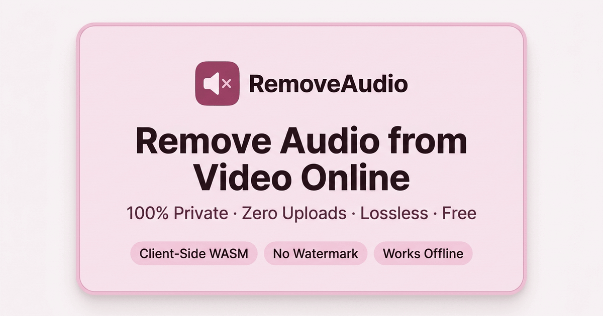
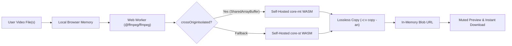

<div align="center">

<a href="https://removeaudio.github.io/">
  
</a>

<h1>RemoveAudio</h1>

<p>
  <strong>Remove audio from videos 100% privately inside your browser using lossless WebAssembly FFmpeg.</strong><br />
  Zero server uploads · Zero data storage · Zero watermarks · Works offline
</p>

<p>
  <a href="https://removeaudio.github.io/"></a>
  <a href="https://astro.build/"></a>
  <a href="https://github.com/ffmpegwasm/ffmpeg.wasm"></a>
  <a href="https://www.typescriptlang.org/"></a>
  <a href="https://removeaudio.github.io/privacy/"></a>
  <a href="./LICENSE"></a>
</p>

<p>
  <a href="https://removeaudio.github.io/">Live Demo</a> &middot;
  <a href="#key-features">Features</a> &middot;
  <a href="#privacy--webassembly-architecture">Architecture</a> &middot;
  <a href="#local-development">Local Dev</a> &middot;
  <a href="#deployment-github-pages">Deployment</a> &middot;
  <a href="#hire-me--custom-it-solutions">Hire Me</a> &middot;
  <a href="#support-the-developer">Support</a>
</p>

</div>

---

## Overview

Most online video muters require uploading large recordings to remote cloud servers, waiting in transcoding queues, and dealing with watermarks or sign-up walls.

**RemoveAudio** eliminates the backend completely. It runs **FFmpeg compiled to WebAssembly** inside a browser Web Worker using **lossless stream copy (`-c:v copy -an`)**—stripping the audio track in milliseconds while keeping 100% of the original video frames untouched and reducing output file size.

---

## Key Features

- **Lossless Instant Muting (`-c:v copy -an`)** — Copies the original video stream without re-encoding, preserving exact resolution, framerate, and bitrate.
- **100% Private & Zero Uploads** — Every video stays in local browser RAM; no file or filename is ever transmitted to a server.
- **Single & Multi-File Batch Queue** — Drop one video for instant muting or queue multiple clips for sequential local processing.
- **Inline Muted Preview & Size Diff** — Preview the muted result directly in-browser and inspect exact original-vs-muted file sizes before saving.
- **Offline-First PWA** — Click **Add to Home Screen** to install and cache the self-hosted FFmpeg WASM core for 100% offline use.
- **8 Built-in Languages** — Instant client-side switching across English (`en`), Español (`es`), Português (`pt`), Deutsch (`de`), Français (`fr`), 日本語 (`ja`), 简体中文 (`zh`), and Русский (`ru`) without page reloads.
- **Accessible Light & Dark Theme** — Soft rose light theme by default with a `localStorage`-persisted dark mode engineered to WCAG AA/AAA contrast ratios.
- **Zero Framework Bloat** — Pure Astro Islands architecture: documentation and static pages ship zero FFmpeg JavaScript.

---

## Supported Formats

| Format | Extensions | Processing Command | Fast-Start Metadata |
| :--- | :--- | :--- | :---: |
| **MP4** | `.mp4` | `ffmpeg -i in.mp4 -c:v copy -an -movflags +faststart out.mp4` | Yes |
| **QuickTime** | `.mov` | `ffmpeg -i in.mov -c:v copy -an -movflags +faststart out.mov` | Yes |
| **WebM** | `.webm` | `ffmpeg -i in.webm -c:v copy -an out.webm` | Container native |
| **Matroska** | `.mkv` | `ffmpeg -i in.mkv -c:v copy -an out.mkv` | Container native |
| **AVI** | `.avi` | `ffmpeg -i in.avi -c:v copy -an out.avi` | Container native |

> If a container contains unusual auxiliary data/subtitle streams that reject default stream copy, the engine automatically retries with `-map 0:v:0 -c:v copy -an`.

---

## Privacy & WebAssembly Architecture



### How `SharedArrayBuffer` + Offline PWA Work Together on GitHub Pages

GitHub Pages does not allow custom HTTP response headers, yet multi-threaded FFmpeg WASM (`@ffmpeg/core-mt`) requires Cross-Origin Isolation (`COOP` + `COEP`). At the same time, only one Service Worker can control scope `/`.

RemoveAudio solves both cleanly with a **unified Service Worker architecture**:

1. **`public/coi-serviceworker.js`** registers `/sw.js` at scope `/` and performs a guarded one-time reload on first visit when `window.crossOriginIsolated` is `false`.
2. **`public/sw.js`** imports `coi-serviceworker.js` and wraps all same-origin network and cached responses with:
   - `Cross-Origin-Opener-Policy: same-origin`
   - `Cross-Origin-Embedder-Policy: credentialless` (enables `SharedArrayBuffer` while keeping third-party analytics unblocked)
   - `Cross-Origin-Resource-Policy: cross-origin`
3. **`public/sw.js`** caches the app shell on install and caches `/ffmpeg/*` WASM binaries on first use or immediately when the user clicks **Add to Home Screen**—enabling 100% offline operation.
4. **`scripts/sync-ffmpeg.mjs`** copies self-hosted ESM worker and WASM core assets from `node_modules` into `public/ffmpeg/` during `postinstall`, `dev`, and `build`, keeping the Git repository lightweight while shipping zero external WASM CDN dependencies in production.

---

## Tech Stack

| Layer | Technology |
| :--- | :--- |
| **Framework** | [Astro 7](https://astro.build/) (Static output, Islands Architecture, `@astrojs/sitemap`) |
| **Media Engine** | [`@ffmpeg/ffmpeg`](https://github.com/ffmpegwasm/ffmpeg.wasm), `@ffmpeg/util`, `@ffmpeg/core-mt`, `@ffmpeg/core` |
| **Language & Styling** | TypeScript (strict), semantic HTML5, zero-dependency CSS3 with custom properties |
| **Offline & Isolation** | Custom Service Worker (`sw.js`) + `coi-serviceworker.js` + Web App Manifest |
| **CI/CD & Hosting** | GitHub Actions (Node.js 24 LTS) & GitHub Pages |
| **AI & Dev Workflow** | Google Antigravity, Google Gemini |

---

## Project Structure

```text
removeaudio.github.io/
├── .github/
│   └── workflows/
│       └── deploy.yml                # GitHub Pages CI/CD (Node.js 24 LTS)
├── public/
│   ├── .nojekyll                     # Serves /_astro/, /ffmpeg/, and XML directly
│   ├── coi-serviceworker.js          # Cross-Origin Isolation bootstrap & header wrapper
│   ├── sw.js                         # Unified Offline PWA + COI Service Worker
│   ├── manifest.webmanifest          # PWA manifest (standalone, theme #F2BED1)
│   ├── favicon.svg                   # Crisp vector favicon
│   ├── og-image.png                  # Optimized 1200x630 Open Graph preview card
│   ├── robots.txt                    # Crawler directives & dual sitemap entries
│   ├── sitemap.xml                   # Standard flat XML 1.0 sitemap for GSC/Bing
│   └── icons/                        # PNG PWA & Apple Touch icons (180/192/512)
├── scripts/
│   └── sync-ffmpeg.mjs               # Syncs FFmpeg worker + WASM cores into public/ffmpeg/
├── src/
│   ├── components/
│   │   ├── Breadcrumbs.astro         # Visual breadcrumbs + BreadcrumbList JSON-LD
│   │   ├── Footer.astro              # Semantic footer + tech stack colophon
│   │   ├── JsonLd.astro              # Structured data script component
│   │   └── VideoAudioRemover.astro   # Interactive client-side audio remover island
│   ├── i18n/
│   │   └── translations.ts           # Reactive 8-language dictionary
│   ├── layouts/
│   │   └── Layout.astro              # Minimal navbar, theme toggle, i18n, PWA, SEO meta
│   ├── lib/
│   │   └── ffmpegEngine.ts           # Typed FFmpeg WASM singleton & lossless runner
│   ├── pages/
│   │   ├── index.astro               # Above-the-fold Hero tool + overview + FAQPage
│   │   ├── how-to-use.astro          # Step-by-step guide + HowTo schema
│   │   ├── privacy.astro             # Zero-upload architecture + WebPage schema
│   │   └── hire-me.astro             # Services card + Copy Email + ContactPage/Person
│   └── styles/
│       └── global.css                # Light/Dark design tokens & responsive UI styles
├── astro.config.mjs                  # Static output, trailingSlash: 'always', sitemap
├── package.json
├── tsconfig.json
└── LICENSE
```

---

## Local Development

### Prerequisites

- **Node.js 24 LTS** (`>=24.0.0`)
- **npm 10+**

### Setup & Commands

```bash
# Clone the repository
git clone https://github.com/removeaudio/removeaudio.github.io.git
cd removeaudio.github.io

# Install dependencies (automatically syncs FFmpeg WASM assets to public/ffmpeg/)
npm install

# Start the development server with COOP/COEP headers
npm run dev

# Type-check with TypeScript
npx tsc --noEmit

# Build the production static bundle into ./dist
npm run build

# Preview the production build locally
npm run preview
```

---

## Deployment (GitHub Pages)

Deployment is fully automated via [`.github/workflows/deploy.yml`](./.github/workflows/deploy.yml) on every push to `main`:

1. Open your repository on GitHub and navigate to **Settings → Pages**.
2. Under **Build and deployment → Source**, select **GitHub Actions**.
3. Push to `main` (or run the workflow manually via **Actions → Deploy RemoveAudio to GitHub Pages → Run workflow**).

Both `/sitemap.xml` (flat XML 1.0) and `/sitemap-index.xml` (generated by `@astrojs/sitemap`) are served with HTTP `200` alongside `/robots.txt` and `/.nojekyll` for immediate Google Search Console and Bing Webmaster discovery.

---

## Hire Me / Custom IT Solutions

Looking for a fast, SEO-engineered web application, a private WebAssembly browser tool, or a high-converting landing page? I am available for freelance projects.

- **Services & Portfolio**: [https://removeaudio.github.io/hire-me/](https://removeaudio.github.io/hire-me/)
- **Direct Email**: [kisharadilshan007@gmail.com](mailto:kisharadilshan007@gmail.com)

---

## Support the Developer

RemoveAudio is completely free, open-source, and ad-free. If it saved you time or kept your workflow private, consider supporting future development:

- **Buy Me a Coffee**: [https://kisharadilshan.gumroad.com/coffee](https://kisharadilshan.gumroad.com/coffee)

---

## License

This project is open source and licensed under the [MIT License](./LICENSE).  
Copyright &copy; 2026 **Kishara Dilshan**.
